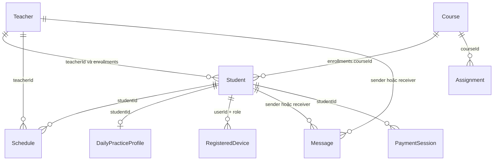

# Database

MongoDB. Tên database lấy từ path của `MONGODB_URI`. Máy dev hiện dùng `dashboardthangtinhoc`. Database test là `thang_tin_hoc_test`, chỉ được reset bằng `scripts/reset-and-seed-test-db.js`.

Schema sống trong `models/`. Một số file trong `modules/**/models` trùng tên. Code đang chạy `require('../models/...')` từ thư mục gốc.

## Quan hệ chính

## Collection then chốt

| Model | Vai trò |
| --- | --- |
| `Student` | Hồ sơ học viên, mật khẩu, ghi danh nhúng `enrollments`, học phí, trạng thái lớp |
| `Teacher` | Giáo viên và tài khoản admin/staff |
| `Course` | Khóa học, giá bắt buộc, slug duy nhất |
| `Schedule` | Buổi dạy. Trạng thái `scheduled`, `completed`, `cancelled`, `no_show` |
| `Assignment`, `Submission` | Bài giao và bài nộp |
| `Message` | Tin trong `conversationId` |
| `Notification` | Thông báo, `receivers`, `read_by` |
| `DailyPracticeProfile` | Ví XP: `dailyXp`, `purchasedXp`, `xpTotal`, `studyXpTotal` |
| `RegisteredDevice` | Tối đa hai thiết bị active mỗi tài khoản và vai trò |
| `UserDeviceSession` | Phiên đăng nhập hiện tại, khác với thiết bị đã đăng ký |
| `PaymentSession` | Phiên thanh toán, có TTL 24 giờ trên `createdAt` |
| `Invoice`, `LedgerEntry`, `Transaction` | Hóa đơn và sổ |
| `SystemSettings` | Một document `_key: main` |
| `LessonSubject`, `LessonUnit`, `LessonItem` | Bài học video và luyện |
| `CertPrepCourse`, `CertPrepLevel`, `CertPrepQuestion`, `CertPrepSession` | Luyện chứng chỉ |

Index và field bắt buộc nằm trong từng file model. Tài liệu này không chép lại toàn bộ field để tránh lệch khi schema đổi. Khi thêm field, sửa model trước rồi mới sửa UI.

## Quy tắc ghi

- Mật khẩu học viên và giáo viên được hash trong `pre('save')`. `insertMany` không chạy hook này.
- Học viên mới có thể được cộng XP chào mừng trong `post('save')` qua `lmsProgressService.grantWelcomeXp`. Lỗi XP không được chặn việc tạo tài khoản.
- Không `dropDatabase` trên URI runtime.
