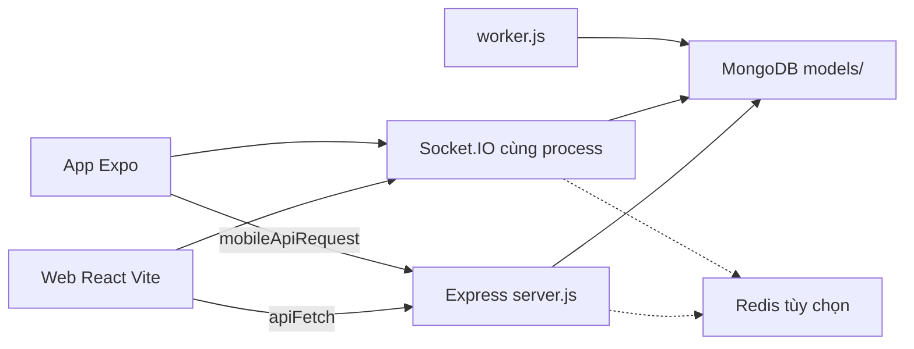
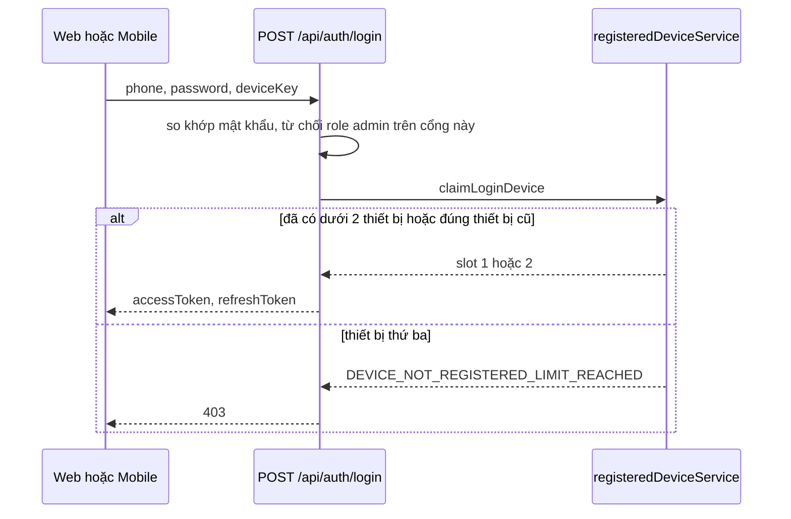
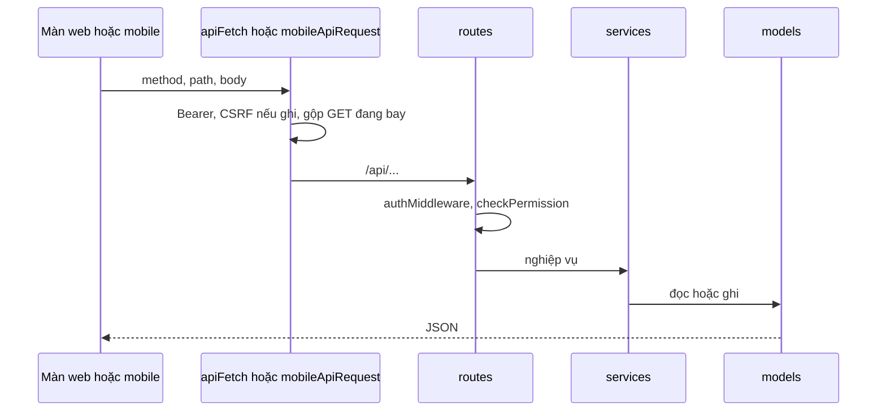
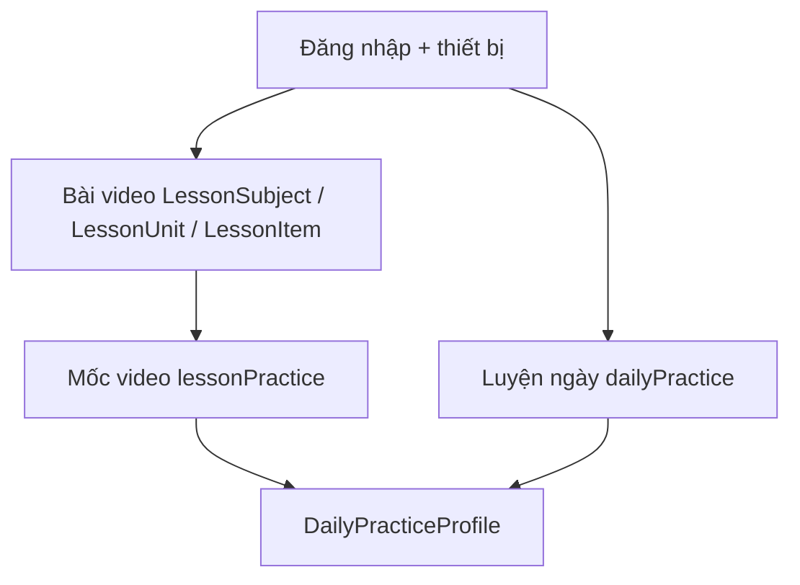
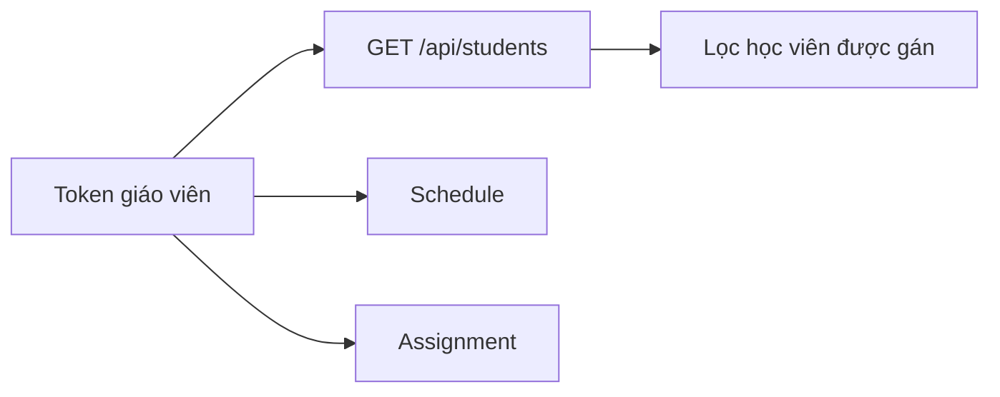
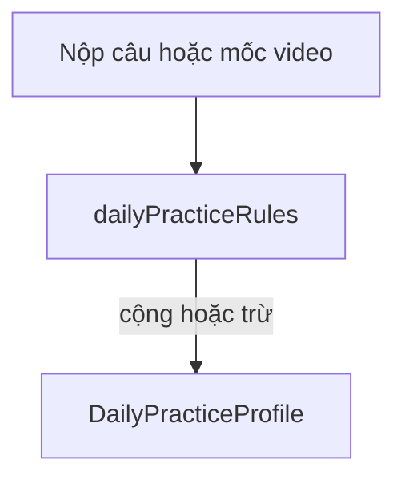
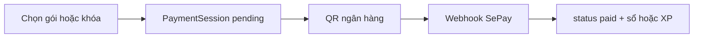
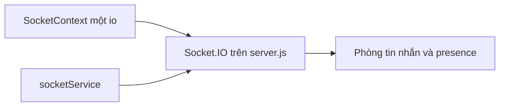

# Kiến trúc hệ thống — LMS Thắng Tin Học

Ngày khảo sát: 2026-11-28. Nhánh `cleanup/unused-code`.

## Ba client, một backend

```text
Trình duyệt (Vite, React 19)
  client/src/services/api.js  ──REST──►  Express server.js
  client/src/context/SocketContext.jsx ──socket.io──► cùng process

App Expo
  thang-tin-hoc-mobile/src/services/apiClient.ts ──REST──► cùng /api
  socketService.ts ──socket.io──► cùng server
        │
        ▼
  MongoDB (Mongoose models/) + Redis (socket adapter, hàng đợi BullMQ) + worker.js
```

`server.js` mount **49** prefix `/api/...`. Logic nghiệp vụ nằm chủ yếu trong `routes/*.js` (khoảng **620** handler) và `services/*.js`. `models/` là schema Mongoose. `worker.js` chạy outbox và job nền, không phải một API gateway thứ hai.

Thư mục `modules/` là bản kiến trúc đang chuyển dần (CQRS / policy). Route đang phục vụ người dùng là `routes/`, không phải bản copy trong `modules/*/routes`. Một số service trong `modules/` vẫn được route thật gọi (học viên, giáo viên, hóa đơn, PDF).

## Web

- Router: `client/src/App.jsx`, lazy theo trang.
- Phiên: access token trong `localStorage` theo tiền tố vai trò (`admin`, `teacher`, `student`, `staff`). `getRolePrefix()` ưu tiên vai trò khớp URL để không dùng nhầm token admin khi đang ở `/student`.
- HTTP: một hàm `apiFetch`. GET/HEAD được retry khi lỗi mạng và 502/503/504. POST/PUT/PATCH/DELETE gắn CSRF, không gộp request. 401 thì `tryRefreshAccessToken` (một promise dùng chung) rồi thử lại một lần. Mã auth chết thì xóa token và đưa về login.
- Dữ liệu admin dùng chung: SWR (`StudentsContext`, `TeachersContext`, `ScheduleContext`, `FinanceContext`, `MessagesContext`) với `dedupingInterval` 30 giây, không refetch khi focus.
- Socket: một `SocketProvider`. Component đăng ký callback qua ref và nhận hàm hủy. Sự kiện `data refresh` được gom trong 320ms.

## Mobile

- Một `mobileApiRequest`. Token trong SecureStore (trên web của Expo thì localStorage). Header `X-Client-Platform: mobile`.
- Refresh token đã là một promise duy nhất (`refreshPromise`).
- `coalesceCached` trong `utils/requestCache.ts` gộp và cache ngắn những lời gọi đã chủ động bọc. Đăng xuất và đổi session xóa cache.
- Socket tạo trong `socketService.ts`, không tạo socket trong từng màn hình.

## Sơ đồ





Đăng xuất và hết hạn token không xóa bản ghi `RegisteredDevice`. Chỉ admin được ủy quyền gọi luồng revoke hoặc reset thiết bị.

## Ranh giới tầng đang chạy

| Việc | Nơi làm |
| --- | --- |
| Khai báo URL | `server.js` rồi `routes/*Routes.js` |
| Nghiệp vụ | `services/` |
| Schema | `models/` |
| Quyền HTTP | `middleware/auth.js` và các `policyShadow*` |
| Gọi API web | `client/src/services/api.js` |
| Gọi API mobile | `thang-tin-hoc-mobile/src/services/apiClient.ts` |
| Realtime | `server.js` và `client/src/context/SocketContext.jsx`, `thang-tin-hoc-mobile/src/services/socketService.ts` |

`modules/` là bản chuyển dần, không phải cây `backend/src/modules` mới. Test khóa việc `server.js` không `require` các route trong `modules/`.

## Luồng API



GET lỗi mạng hoặc 502/503/504 được `apiFetch` thử lại. POST không thử lại và không gộp.

## Học viên học bài



Điểm cộng trừ nằm ở `services/dailyPracticeRules.js`. Ôn lại bài đã xong thì hàm `videoCheckXpConfig` trả mức 0.

## Giáo viên quản lý lớp



Đã đo trên database test: giáo viên nhận 200 và chỉ thấy học viên mình phụ trách. Học viên gọi cùng URL nhận 403.

## XP



Mức ngày: miễn phí 60, mức mặc định trong code 200, Meet còn hạn 300. Chi tiết [GAMIFICATION_LOGIC.md](GAMIFICATION_LOGIC.md).

## Thanh toán



Client không được tự ghi `paid`. Seed test ghi một session `paid` giả, không gọi SePay.

## Socket



Nhiều process API cần `REDIS_URL` thì phòng mới dùng chung. Không có Redis thì mỗi process một bộ nhớ.

## Dữ liệu nhạy cảm không đổi trong đợt này

Đăng nhập, hai thiết bị cố định, phân quyền, XP, thanh toán, lịch, chat, đề thi. Không đổi schema, collection, tên event socket, hay body request.
