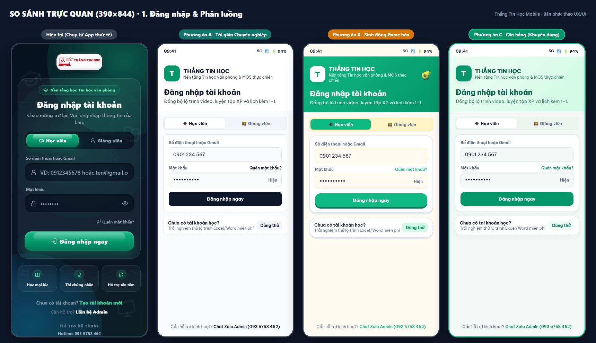
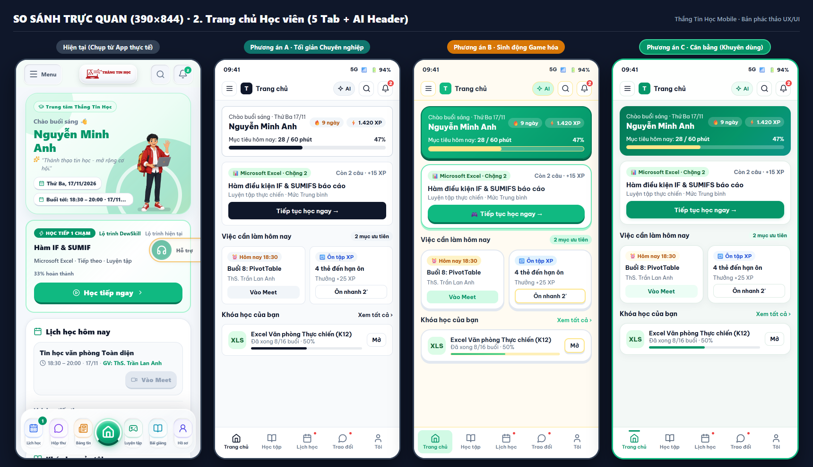
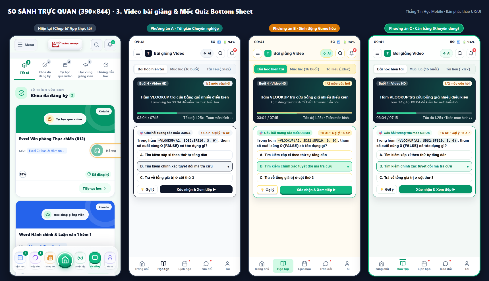
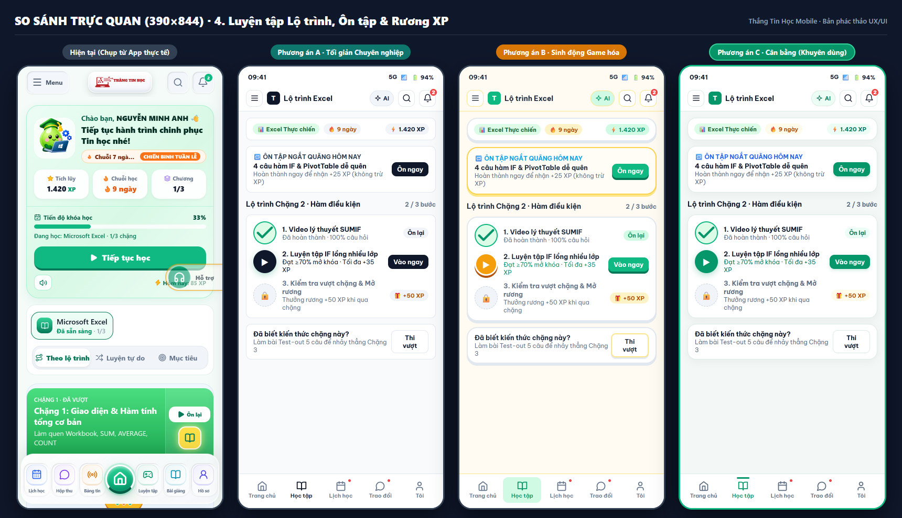
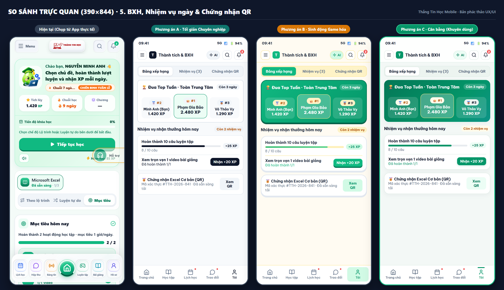
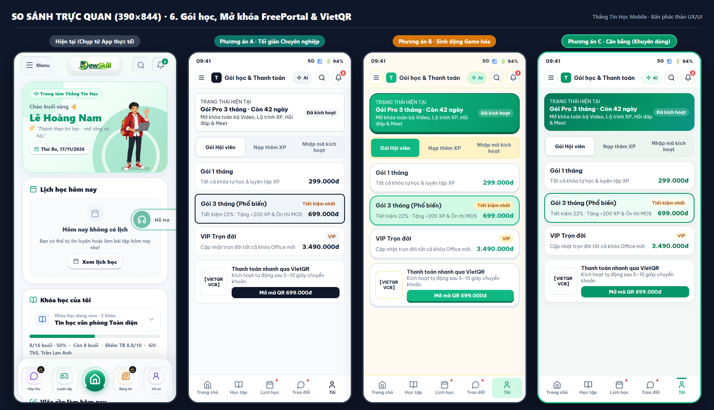
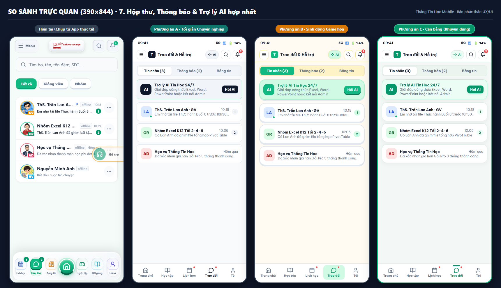
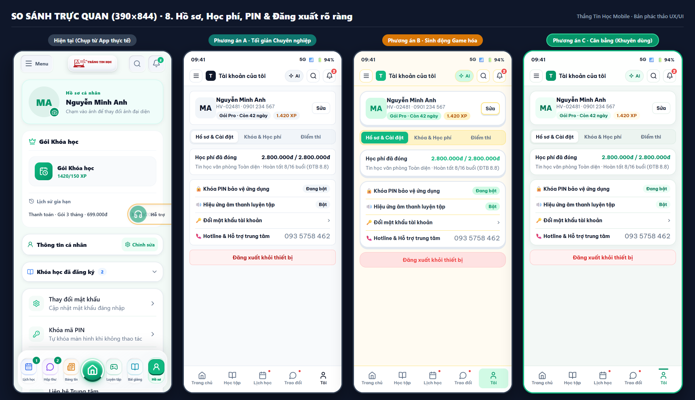
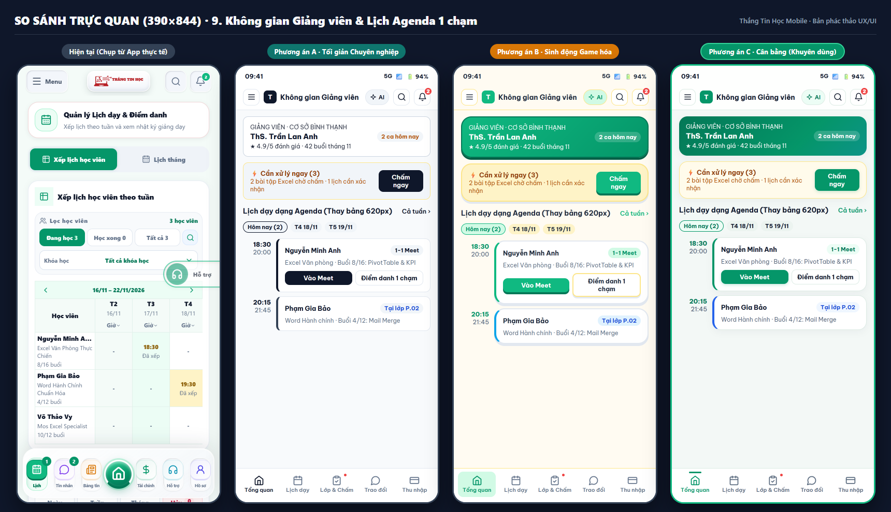
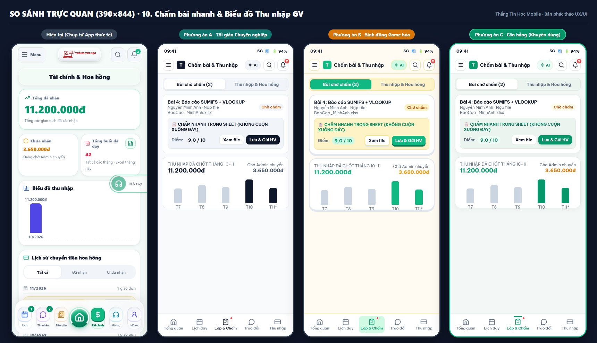

# BÁO CÁO KHẢO SÁT UX/UI & ĐỀ XUẤT THIẾT KẾ LẠI MOBILE APP — THẮNG TIN HỌC

**Phạm vi:** Toàn bộ giao diện & luồng trải nghiệm Học viên (Trả phí, Free Portal, Hết hạn) và Giảng viên trên `thang-tin-hoc-mobile`  
**Trạng thái:** Chỉ khảo sát, đánh giá, dựng prototype độc lập & xuất ảnh phác thảo — **KHÔNG** chỉnh sửa mã nguồn chính, backend, API hay database.  
**Tài liệu trực quan đi kèm:**
- Prototype tương tác HTML (`390×844` · chuyển đổi Phương án A/B/C & so sánh song song): [`prototype/index.html`](./prototype/index.html)
- 19 ảnh chụp thực tế hiện tại (`390×844`): [`current/`](./current/)
- 30 ảnh mockup riêng từng màn (`A / B / C` × 10 nhóm màn): [`mockups/`](./mockups/)
- 10 bảng so sánh trực quan 4 cột (`Hiện tại | PA A | PA B | PA C`): [`comparisons/`](./comparisons/)

---

## GIAI ĐOẠN 1: KHẢO SÁT ỨNG DỤNG HIỆN TẠI

Qua rà soát toàn bộ 174 tệp mã nguồn trong `thang-tin-hoc-mobile/src` kết hợp chạy quan sát thực tế bản Web mobile (`http://localhost:8082` ở kích thước chuẩn `390×844`, cơ chế chặn hoàn toàn ghi dữ liệu API), ứng dụng hiện tại có nền tảng chức năng rất phong phú nhưng đang bộc lộ các nhóm vấn đề lớn về **kiến trúc điều hướng, mật độ thị giác, sự chồng lấn thành phần nổi và bất nhất giữa các màn**:

### 1.1. Thanh điều hướng, Header, Drawer & Nút nổi (Vấn đề nghiêm trọng nhất)
- **Bottom Navigation quá tải (7 tab trên màn 390px):** Cả Học viên (`Schedule`, `Messages`, `Feed`, `Home`, `CourseVideos`, `DailyPractice`, `Profile`) và Giảng viên (`Schedule`, `Messages`, `Feed`, `Home`, `Finance`, `Support`, `Profile`) đều nhồi 7 tab vào thanh viên thuốc nổi cao `96px + safe-area`, mỗi tab chỉ rộng ~50px khiến nhãn `8.5px` chật chội, khoảng chạm hẹp.
- **Lệch chuẩn giữa `MainTabs` và `PersistentTabBar` (`RootNavigator.tsx`):** Tab `Bảng tin` hiển thị icon `Newspaper` ở màn chính nhưng đổi sang `Radio` khi ở các màn phụ (`DailyPractice`, `CourseVideos`, v.v.); `AppHeader` thiếu kiểm tra tab chính với `DailyPractice`, `Finance`, `Support` gây hiện tượng trùng tiêu đề dưới thanh `BrandingTopBar` 58px.
- **Nút nổi `"Hỗ trợ"` (`FloatingSupportButton`) che nội dung & nút CTA:** Trên hầu hết màn chụp thực tế (`02_student_home.png`, `03_student_daily_practice.png`, `04_student_course_videos.png`, `06_student_messages.png`, `08_student_profile.png`, `13_teacher_home.png`, `14_teacher_schedule.png`, `15_teacher_finance.png`), nút nổi `"Hỗ trợ"` viền vàng cam nằm đè trực tiếp lên văn bản, huy hiệu chưa đọc, giờ nhắn tin và cả nút `"Chấm bài >"`. Trên `SupportEntryScreen` của Học viên nút này vẫn nổi đè dù đang ở màn Hỗ trợ.
- **Trùng lặp điểm điều hướng ở 3–4 nơi:** Drawer tối kính (`FloatingNavigationMenu` màu `rgba(13,21,36,0.9)` lạc tông hoàn toàn so với nền sáng bạc hà `#F4FBF8`) lặp lại toàn bộ 7 tab dưới, cộng thêm `MobileMenuScreen` (`ParityScreens.tsx`) và `GlobalSearchOverlay`. Trong Drawer tối (`11_student_drawer_menu.png`), nút **`"Đăng xuất"`** lại tô màu xanh ngọc nổi bật `#34D399` giống nút hành động chính.
- **Tab `"Hỗ trợ"` dành riêng 1 vị trí bottom bar cho Giảng viên (`17_teacher_support.png`)** nhưng chỉ mở ra 1 thẻ nhỏ chiếm 25% màn hình với 75% khoảng trắng.

### 1.2. Bố cục, Màu sắc, Typography, Icon & Button
- **Thiếu nhất quán token (`theme/tokens.ts`):** Hệ thống định nghĩa `micro: 11px` nhưng nhiều màn cứng `8px`, `8.5px`, `9px` với `fontWeight: '800'`/`'900'`. File token vẫn mang chú thích cũ `"tone đỏ"` trong khi màu chủ đạo là xanh ngọc `#059669`.
- **Login (`01_login.png`) nặng thị giác:** Dùng nền tối đậm kèm nhiều vòng aura 420px, nút giả 3D bóng sáng (`Học viên`, `Đăng nhập ngay`), placeholder `"VD: 0912345678 hoặc ten@gmail.c"` bị cắt chữ ngay trong ô nhập, 3 thẻ tính năng dưới cùng chữ nhỏ khó đọc.
- **Trang chủ Học viên (`02_student_home.png`) phân mảnh mục tiêu:** Có tới **4 thẻ cùng trỏ sang `DailyPractice`** (`effectiveLastStudy`, `Việc cần làm`, `DuoHeroCard`, `DuoDailyQuestsCard`), **2 lối vào `CourseVideos`** và **2 lối vào `Schedule`**. Các thành phần như `DailyPracticeHero` bị lặp lại y hệt trong tab `Luyện tập`.

### 1.3. Trải nghiệm Học bài, Video, Luyện tập & Game hóa
- **Trắc nghiệm trong Video (`CourseVideosScreen` & `PathLessonModal`):** Hộp `videoGateOverlay` bên trong `PathLessonModal` đặt đè trong khung `16:9` không có `ScrollView`, dẫn tới cắt mất lựa chọn câu hỏi trên màn hình dọc điện thoại. `MobileLmsPlayerChrome` trên Web bị vỡ thao tác kéo thanh tua và trên Mobile ẩn điều khiển âm lượng vào `onLongPress` không có gợi ý.
- **Bẫy XP & Đứt mạch luyện tập (`DailyPracticeScreen`):**
  - Màn `ResultView` (xem lại các câu trả lời sai & gợi ý bài giảng liên quan) đang tồn tại trong code nhưng không bao giờ được hiển thị do luồng đi qua `PracticeFinishOverlay`.
  - Mọi bước lộ trình đều ép chờ **3 giây đếm ngược (`StakeSessionConfirm`)** trước khi vào làm bài.
  - Phạt chờ sai câu lệch chuẩn giữa Luyện tập hằng ngày (**5s**) và Video bài giảng (**10s**).
  - Rương chặng (`UnitStageChest`) ghi cứng `'50 XP'` không theo giá trị thực của chặng; hộp thoại thoát (`QuitConfirm`) cảnh báo sai `"Bạn sẽ mất chuỗi hôm nay!"` dù đã `playedToday`; bảng `DailyPracticeGoalPanel` nội suy chấm `T2–CN` thay vì lấy đúng lịch sử thật; `StudyMilestoneOverlay` ghi cứng `"1/1"`.
  - Chức năng rất hay là **`SpacedReviewCard` (Ôn tập ngắt quãng)** và **`PlacementEntryCard`** bị giấu sâu trong tab `'Mục tiêu'`. Nút **`"Chứng nhận QR"`** hiện khóa oan đối với học viên trả phí (`freePortal && topicPathDone`).
  - Lỗi hiển thị ở `18_student_missions_goal.png`: badge `"Chuỗi 7 ngà..."` bị cắt chữ và số liệu `"Chương — | Tiến độ khóa học 0%"` mất trạng thái khi chuyển tab.

### 1.4. Gói học, Thanh toán FreePortal, Hồ sơ & Thông báo
- **Mâu thuẫn luồng mở khóa FreePortal:** `FreeFeatureLockModal` thông báo phải **mua Gói Meet**, trong khi bước cuối `FreeSurveyModal` lại hướng dẫn **mua bất kỳ gói XP nào** ở mục Luyện tập để mở khóa đủ 4 tính năng. `FreeSurveyModal` bắt buộc qua 3 bước + hướng dẫn chặn toàn màn hình, và hộp báo lỗi lại dùng màu xanh lá `errorBox`.
- **Trùng lặp thanh toán QR & Modal xếp chồng:** `FreeMeetPlanModal`, `BuyXpModal` tự cài đặt lại luồng QR/polling thay vì dùng chung `CoursePaymentModal`; `RootNavigator` gắn 8 modal độc lập không có hàng đợi ưu tiên.
- **Lỗi dữ liệu hiển thị ở Hồ sơ & Thông báo (`08_student_profile.png`, `09_student_notifications.png`):**
  - Thẻ **`"Gói Khóa học"`** trong Hồ sơ và Drawer lại in nhầm **`1420/150 XP`** thay vì tên gói và số ngày còn hạn.
  - Trên tài khoản Học viên, thông báo lịch học vẫn gắn nhãn **`"Lịch dạy"`**.
  - Ở `Hộp thư` (`06_student_messages.png`), mọi người đều hiện badge **`offline`** kể cả chính học viên đang đăng nhập xuất hiện trong danh sách liên hệ.
  - Trang `GradesScreen` (`FeatureScreens.tsx`) vẫn để khung `"WEB-ONLY TẠM THỜI"` dù `StudentExamScreen` đã hỗ trợ xem điểm trực tiếp.

### 1.5. Trải nghiệm Giảng viên (`13_teacher_home.png` – `17_teacher_assignments.png`)
- **Lịch tuần 620px bóp nghẹt trên màn 390px (`14_teacher_schedule.png`):** Bảng xếp lịch tuần bắt cuộn ngang, chỉ hiện được cột `T2, T3, T4` còn tên học viên bị cắt (`"Nguyễn Minh A..."`). Hai tầng bộ lọc tiêu tốn gần nửa màn hình trước khi thấy ca dạy đầu tiên. Tác vụ `'Điểm danh bù'` mở Alert gửi chuỗi mã hóa `⟦student_detail:...⟧` qua tin nhắn cho Admin.
- **Giao bài & Chấm bài phức tạp (`AssignmentsScreen` & `TeacherQuizzesScreen`):** Hai màn trỏ vòng sang nhau dưới cùng 1 tiêu đề `"Giao bài tập & kiểm tra"`. Khi Giảng viên bấm chấm bài, form chấm không mở Modal/Sheet mà mở ở **đáy `ScrollView`** kèm `scrollToEnd`. Tạo đề quiz dồn tất cả vào 1 modal khổng lồ (chọn khóa, tick từng học viên, 2 bộ chọn ngày/giờ, nhập/xuất Excel, tạo AI Gemini, sửa A–D).
- **Cập nhật học viên rời rạc (`StudentsScreen`):** Cần tới 3 nút `Lưu` tách rời (`Lưu điểm`, `Lưu link`, `Lưu ghi chú`) ngay cạnh nút nguy hiểm `Đánh trượt và khóa phòng thi`.

---

## GIAI ĐOẠN 2: ĐỀ XUẤT CẢI TIẾN (4 NHÓM HÀNH ĐỘNG)

| Nhóm | Hạng mục cụ thể | Đối tượng hưởng lợi chính |
| :--- | :--- | :--- |
| **1. GIỮ NGUYÊN** *(Những phần đã tốt)* | • Bảng màu thương hiệu xanh ngọc `#059669` + điểm nhấn hổ phách `#F59E0B` cho XP/Streak. • Logic học sâu: Bắt buộc trả lời đúng các mốc tương tác mới qua đoạn video; không trừ XP khi ôn lại bài đã đạt; quy đổi gợi ý rõ ràng. • Lộ trình chặng (Path Nodes), Test-out vượt chặng, Ôn tập ngắt quãng (Spaced Review), Rương chặng. • Quy trình thanh toán VietQR tự động kiểm tra giao dịch, mã kích hoạt thẻ, khóa PIN & Trợ lý AI Tin học có chuyển tiếp Admin. • Hàng đợi `"Cần xử lý"` (bài chờ chấm, lịch chờ xác nhận) trên Trang chủ Giảng viên. | • **Học viên:** Giữ nguyên thói quen & động lực học gamified. • **Giảng viên:** Giữ cảnh báo việc gấp chính xác. • **Nhà cung cấp:** Bảo toàn 100% logic kinh doanh & doanh thu VietQR. |
| **2. THIẾT KẾ LẠI** *(Chưa đẹp / Bất tiện)* | • **Thanh điều hướng dưới từ 7 tab → 5 tab** rạch ròi theo vai trò (`Trang chủ · Học tập · Lịch · Trao đổi · Tôi` cho HV; `Tổng quan · Lịch dạy · Lớp & Chấm · Trao đổi · Thu nhập` cho GV). • **Đưa nút AI / Hỗ trợ lên góc phải Top Bar** (xóa hoàn toàn nút nổi đè nút bấm và chữ). • **Login sáng, thoáng**, bỏ aura nặng & cắt placeholder. • **Trắc nghiệm mốc Video dạng Bottom-Sheet/Card dưới player `16:9`** (chạm mượt trên dọc màn hình, kéo tua & âm lượng chuẩn). • **Lịch dạy & Lịch học từ bảng 620px → Agenda Timeline theo ngày** với thao tác 1 chạm (`Vào Meet`, `Điểm danh`). • **Chấm bài bằng Bottom-Sheet**, lưu gom 1 nút trong Chi tiết Học viên, tách rạch ròi **Thời hạn Gói** và **Ví XP** trong Hồ sơ, Drawer sáng đồng bộ theme và nút Đăng xuất màu đỏ cảnh báo. | • **Học viên:** Học 1 tay thoải mái, không bị che nút, không cắt chữ câu hỏi video. • **Giảng viên:** Chấm bài & điểm danh nhanh gấp đôi trên điện thoại giữa các ca dạy. • **Nhà cung cấp:** Giảm tỷ lệ thoát màn hình (drop-off), nâng tầm chuyên nghiệp EdTech. |
| **3. BỔ SUNG** *(Tăng hứng thú & chuyển đổi)* | • **Thẻ "Mục tiêu hôm nay" + Tiến trình phút học + "Học tiếp 1 chạm" hợp nhất** ngay đầu Trang chủ. • **Đưa Ôn tập ngắt quãng (Spaced Review) lên đầu tab Luyện tập** kèm nút **"Ôn ngay 2 phút"**. • **Hiển thị lại màn Review câu sai** sau mỗi lượt luyện để học viên nhớ sâu mẹo Office. • **Mở Chứng nhận QR** cho toàn bộ học viên đủ điều kiện (không khóa oan tài khoản trả phí) + nút Chia sẻ thành tích. • **Biểu đồ cột thu nhập đa tháng** cho Giảng viên (thay vì 1 cột đơn) & thanh tiến trình so sánh Free vs Pro trực quan trước khi thanh toán. | • **Học viên:** Tăng tỷ lệ quay lại mỗi ngày (D7/D30 retention). • **Giảng viên:** Minh bạch thu nhập từng tháng. • **Nhà cung cấp:** Tăng chuyển đổi Free Portal → Gói Pro/Khóa video. |
| **4. GỘP HOẶC ẨN** *(Trùng lặp / Chiếm chỗ)* | • **Gộp `DailyPractice` + `CourseVideos` + `CertPrep`** vào 1 Hub **`Học tập`** có segmented tab rõ ràng (xóa cảnh Home có 4 thẻ cùng dẫn về DailyPractice). • **Gộp `Messages` + `Feed` + `Notifications`** vào 1 Hub **`Trao đổi`** + nút chuông Top Bar. • **Gộp `FreeMeetPlanModal`, `BuyXpModal`, `CoursePaymentModal`** thành **1 Luồng Gói học & Thanh toán VietQR thống nhất**, chấm dứt mâu thuẫn ngữ nghĩa FreePortal. • **Gộp tab lọc dư thừa**: 5 tab CourseVideos → 2 tab (`Của tôi / Khám phá`); 5 pill Nhật ký Schedule → Select gọn; gộp `Assignments` & `TeacherQuizzes` thành `Lớp & Chấm`; ẩn `GradesScreen` ("WEB-ONLY") và 4 card mồ côi khỏi codebase. • **Ẩn badge `offline` thừa** ở Hộp thư và lọc bỏ bản thân khỏi danh bạ chat. | • **Học viên:** Giảm số bước tìm tính năng từ 3–4 chạm còn 1–2 chạm. • **Giảng viên:** Giảm 40% bề mặt màn quản lý phải bảo trì. • **Nhà cung cấp:** Mã nguồn gọn hơn, ít lỗi đồng bộ khi phát triển tính năng mới. |

### Phân tích lợi ích tổng thể
- **Với Học viên:** Lộ trình học Office (Word, Excel, PowerPoint, MOS) mạch lạc từ Video → Thực hành → Ôn tập → Chứng nhận QR; không bị gián đoạn bởi đếm ngược 3s thừa hay khung câu hỏi bị cắt.
- **Với Giảng viên:** Quản lý ca dạy 1-1/nhóm theo trục thời gian dễ nhìn bằng 1 tay ngoài hiện trường, chấm bài & ghi chú nhanh ngay trong sheet trượt thay vì cuộn xuống đáy trang.
- **Với Nhà cung cấp (Thắng Tin Học):** Gói nâng cấp & nạp XP rõ ràng giúp tăng chuyển đổi Free Portal; giảm chi phí hỗ trợ kỹ thuật nhờ xóa các lỗi hiển thị (1420/150 XP trong Gói khóa học, lệch nhãn Lịch dạy/Lịch học, nút nổi che nội dung).

---

## GIAI ĐOẠN 3: PHÁC THẢO TRỰC QUAN 3 PHƯƠNG ÁN & SO SÁNH TỪNG MÀN HÌNH

Cả 3 phương án đều tuân thủ đúng khung kích thước điện thoại thực tế **`390×844`**, giữ nguyên 100% nghiệp vụ cốt lõi và đã xuất ảnh so sánh 4 cột (**Hiện tại thực tế | Phương án A | Phương án B | Phương án C**):
- **Phương án A — Minimal Academic Clean (Tối giản, Hiện đại, Chuyên nghiệp):** Nền xám lạnh `#F8FAFC`, viền mảnh `1px #E2E8F0`, chữ đen Slate `#0F172A`, màu nhấn tiết chế, ưu tiên sự tập trung và mật độ thông tin quản trị cao.
- **Phương án B — Vibrant Gamified DewSkill (Sinh động, Game hóa, Tạo hứng thú):** Nền kem ấm `#FFFBF2`, linh vật 🥑 Bé Đậu, nút 3D viền đáy dày, thanh tiến trình rực rỡ, thẻ vàng/ngọc kích thích cảm giác chinh phục thử thách.
- **Phương án C — Hybrid Pro Office + DewSkill (Kết hợp Chuyên nghiệp & Game hóa · KHUYÊN DÙNG):** Nền ngọc nhạt `#F3F8F6`, thẻ trắng bo `16px` đổ bóng nhẹ, badge phân môn theo bộ màu quen thuộc của Microsoft Office (**Excel xanh lá**, **Word xanh dương**, **PowerPoint cam**), kết hợp gamification vừa đủ tại vùng học/luyện tập trong khi giữ sự nghiêm túc chuẩn xác tại Lịch học, Thanh toán và Không gian Giảng viên.

---

### Màn hình 1: Đăng nhập & Phân luồng

- **Hiện tại vs Đề xuất:** Bỏ nền tối rườm rà nhiều lớp aura và nút giả 3D; chuyển sang bố cục sáng rõ 2 phần (Thương hiệu phía trên + Thẻ form sắc nét phía dưới), mở rộng ô nhập tránh cắt placeholder `"ten@gmail.c"`, tách rõ khối `"Dùng thử Free Portal"` bên dưới thay vì 4 link dồn đáy.
- **Lợi ích:** Rút ngắn thời gian đọc màn đầu tiên, giảm mỏi mắt và phân luồng Học viên / Giảng viên / Dùng thử miễn phí chỉ trong 1 chạm.

---

### Màn hình 2: Trang chủ Học viên (Header + 5 Tab + Mục tiêu ngày)

- **Những điểm thay đổi:** Giảm 7 tab dưới xuống 5 tab thoáng rộng; chuyển Trợ lý AI lên thanh Top Bar thay cho nút nổi `"Hỗ trợ"` (hết che nút CTA); gộp Lời chào + Chuỗi ngày + XP + Thanh tiến trình **"Giờ học hôm nay (28/60 phút)"** vào 1 Hero duy nhất; giữ duy nhất 1 khối **"Học tiếp 1 chạm"** và **lưới 2 cột Việc cần làm (Lịch Meet & Ôn tập XP)**.
- **Thành phần gộp:** Loại bỏ sự trùng lặp 4 thẻ cùng nhảy sang `DailyPractice`.
- **Lợi ích:** Mọi thông số quan trọng nhất nằm gọn trên màn hình đầu tiên không cần cuộn sâu.

---

### Màn hình 3: Video bài giảng & Trắc nghiệm mốc tương tác

- **Những điểm thay đổi:** Giảm 5 tab lọc khóa thành 3 tab trong khóa (`Bài học hiện tại · Mục lục · Tài liệu .xlsx`); cố định khung Video `16:9` sắc nét ở trên và đặt **Câu hỏi mốc tương tác (ví dụ 03:04) ở Card/Bottom-Sheet ngay bên dưới video**, kèm thanh tiến trình xem, chip `+5 XP / Gợi ý -5 XP`, nút `"Gợi ý"` và `"Xác nhận & Xem tiếp ▶"`.
- **Lý do thay đổi:** Khắc phục triệt để lỗi hộp trắc nghiệm bị cắt mất đáp án trên màn dọc `PathLessonModal` và thanh tua video bị kẹt.

---

### Màn hình 4: Luyện tập Lộ trình, Ôn tập ngắt quãng & Rương XP

- **Những điểm thay đổi:** Đưa khối **Ôn tập ngắt quãng (`SpacedReview`)** lên đầu màn với 1 nút `"Ôn ngay"`, ngay phía trên trục lộ trình chặng trực quan (`Video` → `Luyện tập` → `Kiểm tra & Rương +50 XP` đúng số liệu thực); đặt thẻ `Test-out (Thi vượt)` gọn gàng cuối trang; loại bỏ màn chờ đếm ngược 3s cưỡng bức.
- **Lợi ích:** Học viên thấy ngay bài cần ôn (không trừ XP) và bước tiếp theo cần chinh phục.

---

### Màn hình 5: Bảng xếp hạng, Nhiệm vụ ngày & Chứng nhận QR

- **Những điểm thay đổi:** Hợp nhất `Bảng xếp hạng · Nhiệm vụ (3) · Chứng nhận QR` vào 1 Hub Thành tích; nâng cấp Bục Podium Top 3 trực quan; sửa lỗi `18_student_missions_goal.png` bị cắt chữ `"Chuỗi 7 ngà..."` và mất số % khi chuyển tab; bổ sung thẻ tải/chia sẻ **Chứng nhận QR** cho cả học viên trả phí đủ điều kiện.

---

### Màn hình 6: Gói học, Mở khóa FreePortal & Thanh toán VietQR

- **Những điểm thay đổi:** Hợp nhất hoàn toàn trải nghiệm `FreeFeatureLock`, `FreeMeetPlanModal`, `BuyXpModal` và `CoursePaymentModal` vào 1 màn phân 3 tab (`Gói Hội viên · Nạp thêm XP · Nhập mã kích hoạt`) kèm thẻ trạng thái rõ ràng ở đầu và khung VietQR nhanh ở cuối.
- **Lý do thay đổi:** Xóa mâu thuẫn giữa modal báo mua Meet với màn hướng dẫn bảo mua XP, rút ngắn phễu chuyển đổi từ Free sang trả phí còn 2 chạm.

---

### Màn hình 7: Hộp thư, Thông báo & Trợ lý AI hợp nhất

- **Những điểm thay đổi:** Gộp `Tin nhắn · Thông báo · Bảng tin` vào chung tab **`Trao đổi`** và ghim thẻ **`Trợ lý AI Tin Học 24/7`** ngay đầu danh sách (bên cạnh lối vào nhanh trên Top Bar); bỏ nhãn `offline` giả trên mọi hàng và lọc chính tài khoản đang đăng nhập khỏi danh bạ; sửa nhãn `"Lịch dạy"` thành `"Lịch học"` trên luồng Học viên.

---

### Màn hình 8: Hồ sơ, Học phí, Bảo mật PIN & Đăng xuất

- **Những điểm thay đổi:** Khắc phục triệt để lỗi hiển thị **`1420/150 XP`** bên trong hộp **`"Gói Khóa học"`** — tách thành 2 huy hiệu rõ ràng: **`Gói Pro · Còn 42 ngày`** và **`1.420 XP`**; gộp thông tin cá nhân, **Khóa học & Học phí (`2.800.000đ / 2.800.000đ`)**, **Điểm thi** vào 3 sub-tab; đặt nút **`Đăng xuất khỏi thiết bị`** màu đỏ ngữ nghĩa rõ ràng ở cuối trang và đồng bộ Drawer sáng sạch.

---

### Màn hình 9: Không gian Giảng viên & Lịch dạy Agenda 1 chạm

- **Những điểm thay đổi:** Đưa dải cảnh báo **`⚡ Cần xử lý ngay (Bài chờ chấm, Lịch chờ xác nhận)`** lên đầu Trang chủ Giảng viên; thay thế hoàn toàn bảng tuần rộng `620px` (bị cắt cột `T5–CN` và cắt tên học viên) bằng **Lịch dạy dạng Agenda Timeline dọc (`18:30`, `20:15`)** kèm bộ chọn ngày nhanh (`Hôm nay · T4 · T5`) và 2 nút 1 chạm ngay trên ca học: **`Vào Meet`** & **`Điểm danh 1 chạm`**.

---

### Màn hình 10: Chấm bài nhanh & Biểu đồ Thu nhập Giảng viên

- **Những điểm thay đổi:** Hợp nhất Bài tập về nhà và Trắc nghiệm trong 1 không gian `Lớp & Chấm`, mở khung **Chấm bài ngay tại thẻ / Bottom-Sheet** (thay cho cơ chế cuộn xuống đáy `scrollToEnd` dễ lạc); nâng cấp **Biểu đồ Thu nhập** từ 1 cột đơn thành chuỗi so sánh nhiều tháng (`T7 → T11*`) đi kèm tổng đã chốt (`11.200.000đ`) và chờ Admin chuyển (`3.650.000đ`).

---

## GIAI ĐOẠN 4: BẢNG SO SÁNH 3 PHƯƠNG ÁN & KHUYẾN NGHỊ PHÊ DUYỆT

| Tiêu chí đánh giá | Phương án A *(Tối giản Chuyên nghiệp)* | Phương án B *(Sinh động Game hóa)* | Phương án C *(Khuyên dùng)* *(Chuyên nghiệp + Game hóa)* |
| :--- | :---: | :---: | :---: |
| **Tính thẩm mỹ** | ★★★★☆ (Sạch, sắc nét kiểu Notion/Linear) | ★★★★☆ (Vui tươi, bắt mắt như Duolingo) | ★★★★★ (Hài hòa hiện đại, đúng chất EdTech Tin học) |
| **Mức độ dễ sử dụng** | ★★★★★ (Phân cấp chữ rõ, ít nhiễu nhất) | ★★★★☆ (Nhiều màu & viền dày, hơi rực với GV) | ★★★★★ (Thao tác 1 chạm mượt cho cả HV & GV) |
| **Khả năng giữ chân học viên** | ★★★☆☆ (Thiếu điểm nhấn thưởng & phấn khích) | ★★★★★ (Rất mạnh cho tự học hằng ngày) | ★★★★☆ (Cân bằng tốt: XP/Streak ở vùng học + nghiêm túc khi học 1-1) |
| **Mức độ chuyên nghiệp thương hiệu** | ★★★★★ (Hợp doanh nghiệp & luyện thi MOS) | ★★★☆☆ (Hơi trẻ hóa khi Giảng viên xem Thu nhập/Lịch) | ★★★★★ (Giữ trọn uy tín trung tâm Tin học văn phòng) |
| **Độ phức tạp triển khai & Bảo trì** | **Thấp–Trung bình** *(Chỉ cần `StyleSheet` + `lucide`, 0 thư viện mới)* | **Cao** *(Cần thêm asset linh vật 3D, hiệu ứng nút nổi & màu theo trạng thái)* | **Trung bình** *(Tái sử dụng 95% kiến trúc RN hiện tại, chuẩn hóa lại tokens & 5-tab)* |

### Đề xuất của Designer
Khuyến nghị **chọn Phương án C (Kết hợp Chuyên nghiệp & Game hóa)** vì giải quyết toàn bộ điểm nghẽn hiện tại (bố cục 5 tab, xóa nút nổi che chữ, tách Trắc nghiệm video ra Bottom Sheet, đổi lịch bảng 620px sang Agenda Timeline, sửa lỗi dữ liệu Hồ sơ/Thông báo/FreePortal) với chi phí kỹ thuật vừa phải, không đòi hỏi cài thư viện nặng và giữ hình ảnh trung tâm Tin học vừa chuyên nghiệp với Giảng viên/người đi làm vừa thú vị với học viên tự học hằng ngày.

---

> **TRẠNG THÁI CHỜ PHÊ DUYỆT:**  
> Toàn bộ mã nguồn `thang-tin-hoc-mobile`, backend API và database vẫn **nguyên vẹn 100%**.  
> Vui lòng xem bộ mockup trong `docs/mobile-ux-redesign/comparisons/`, trải nghiệm prototype tại `docs/mobile-ux-redesign/prototype/index.html`, và phản hồi rõ ràng ***"Tôi duyệt phương án [A / B / C], hãy bắt đầu code"*** khi bạn sẵn sàng để tôi tiến hành triển khai vào ứng dụng chính.
